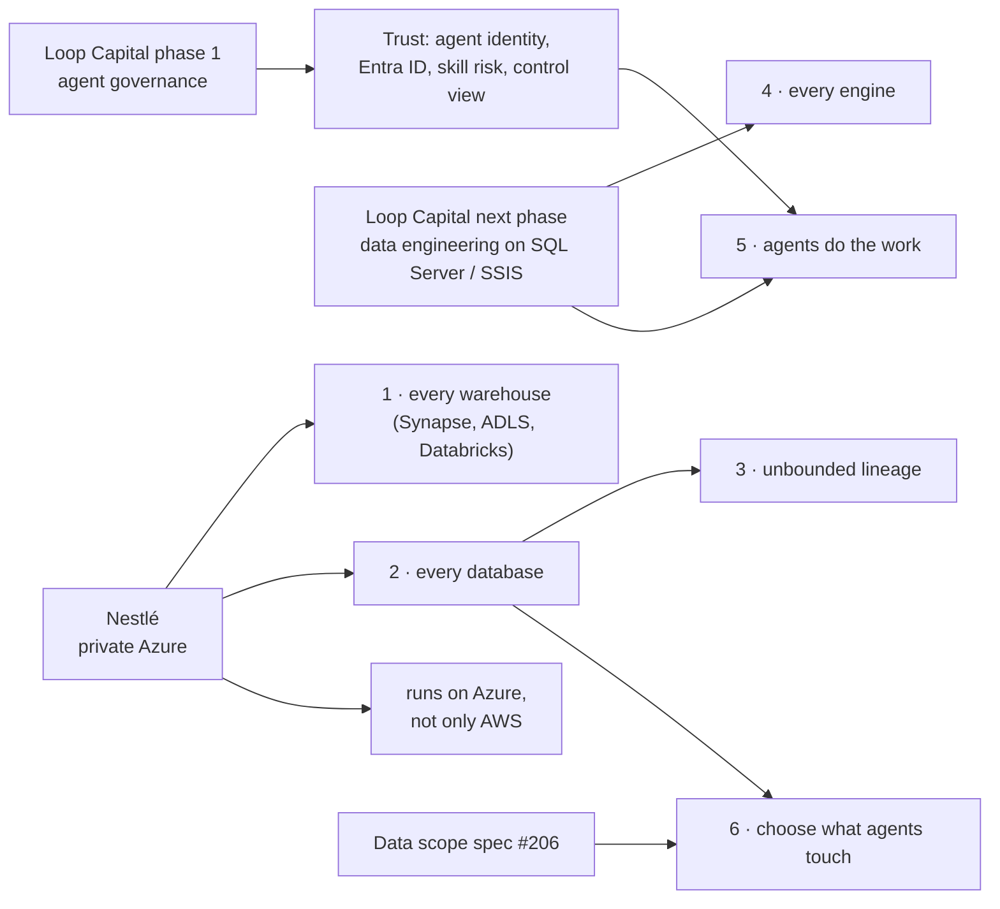

# Brighthive north star

> **Every warehouse, every database, every engine — glued into one estate by Brighthive, with BrightAgents
> doing the data engineering.** A team connects whatever it runs, sees one lineage from source to report, picks
> exactly what an agent may work on, and hands the routine work to agents that build, watch and repair
> pipelines under human approval.

Evidence date: 2026-10-20, read from code (brightbot `origin/main` / `develop`, platform-core `v3.1.1.5-release` /
`develop`, webapp `develop`). Legend: 🟢 in production · 🟡 partial, staging-only, or in an open PR · ⚪ absent.

## The promise, in seven parts

| # | Part | What a customer gets | Today | After open PRs merge |
|---|---|---|---|---|
| 1 | **Every warehouse** | Connect Snowflake, Redshift, Synapse, SQL Server, Databricks, Postgres, BigQuery | 🟢 Snowflake, Redshift, Synapse, SQL Server · 🟡 Postgres and Databricks have code but can't be registered · ⚪ BigQuery | unchanged |
| 2 | **Every database** | Each warehouse's databases are real, addressable, with one default | ⚪ databases were strings; 21 code paths took "the first warehouse" | 🟡 DatabaseNode (pcore #1362/#1363); default-never-first, every warehouse watched (brightbot #1189–#1196) |
| 3 | **Unbounded lineage** | One graph from source → ingestion → warehouse → transformation → report | 🟡 up to 20 hops, **within one engine**; matched by bare table name | 🟡 lineage from every warehouse, each on its own warehouse's tables (#1192, #1195) — still no cross-engine stitching |
| 4 | **Every engine** | dbt, Airbyte, SSIS, ADF, Databricks Jobs, Snowflake Tasks — watched, run, authored, repaired | 🟢 dbt Cloud full lifecycle · 🟡 others watch-only or diagnose-only · ⚪ ADF, Glue, Fivetran, Airflow | unchanged |
| 5 | **Agents do the data engineering** | BrightAgents build, run, watch and fix — never self-merging | 🟢 supervisor + 7 sub-agents; fix PRs can't self-merge · ⚠️ chat merge has no code gate; chat writes skip confirm | unchanged |
| 6 | **Choose exactly what agents touch** | Include / exclude any warehouse, database, schema, table, column | 🟡 per-turn `@warehouse` pin only; no exclude, nothing saved | spec ready ([#206](https://github.com/brighthive/agentic-project-mgmt/pull/206)); build tickets SC-1…SC-8 proposed |
| 7 | **The Project is the glue** | Every feature meets in one Project | 🟢 warehouse, dbt models, data products, specs bind · ⚪ ingestion, quality rules, routines, on-prem runs, repo, agent threads do not | unchanged |

**Trust underneath all seven:** permission matrix in production but in log-only mode by default; human approval on
agent writes; per-action audit lines; Okta/OIDC federation. Agents have no identity of their own and there is no
Entra ID support yet — see [Loop phase 1](trials/loopcapital/PHASE1_GOVERNANCE.md).

## How each client moves the north star

- **Loop Capital** phase 1 builds the trust layer that lets agents act for a regulated firm; the data-engineering
  trial that was phase 1 becomes phase 2 and pulls parts 4 and 5. Detail: [PHASE1_GOVERNANCE.md](trials/loopcapital/PHASE1_GOVERNANCE.md).
- **Nestlé** asks for the same platform inside its own Azure: parts 1 and 2 on Synapse / ADLS / Databricks, plus a
  deployment we don't have yet. Detail: [AZURE_ARCHITECTURE.md](trials/nestle/AZURE_ARCHITECTURE.md).
- **Shared build, both clients:** Entra ID sign-in, per-agent identity, a durable audit store, model-provider choice —
  see [ALIGNMENT_2026-10.md](ALIGNMENT_2026-10.md).

## What is in flight (all draft)

| PR | Part | What it changes |
|---|---|---|
| [agentic-project-mgmt #206](https://github.com/brighthive/agentic-project-mgmt/pull/206) | 6 | Data scope spec: include/exclude down to column, deny-overrides, fail closed |
| [platform-core #1362](https://github.com/brighthive/brighthive-platform-core/pull/1362) → [#1363](https://github.com/brighthive/brighthive-platform-core/pull/1363) | 2 | DatabaseNode under its warehouse; default database; backfill |
| [brightbot #1189](https://github.com/brighthive/brightbot/pull/1189) → … → [#1196](https://github.com/brighthive/brightbot/pull/1196) | 2, 3 | Default warehouse never "first"; every warehouse watched and gets lineage; bad pins fail closed; stalled warehouses report Down; typeless warehouse never runs as Redshift |

## Biggest gaps, ranked by how much of the promise they unlock

| Gap | Unlocks | Where it would live |
|---|---|---|
| Lineage stitched across systems (source / Airbyte → warehouse → dbt → BI), on full-path identity | 3, 7 | brightbot lineage + platform-core nodes for sources and reports |
| A provider choice on transformation services so Databricks / Snowflake runners can actually be called | 4 | platform-core `TransformationService` + brightbot `build_runner` (adapters exist, nothing reaches them) |
| Cloud agent drives the on-prem runner (the `OnPremJob` queue has no producer) | 4, 5 | brightbot |
| Airbyte run status → watched and repaired like dbt | 4, 5 | brightbot `PipelineSource` |
| Code-level gates on chat merge and chat writes | 5 | brightbot tool layer |
| Data scope build (SC-1…SC-8) | 6 | platform-core + brightbot + webapp |
| Project edges for ingestion, quality rules, routines, runs, repo | 7 | platform-core OGM |
| Postgres / Databricks registrable; BigQuery adapter | 1 | platform-core engine list + OpenMetadata map |
| Azure deployment (images, charts, IaC, Entra, model provider) | Nestlé | new — see Azure file |

## What this page is not

Not a commitment or a roadmap with dates — it is the yardstick every client ask and epic is measured against.
Update the "Today" column only from code or a live check, with the date.
