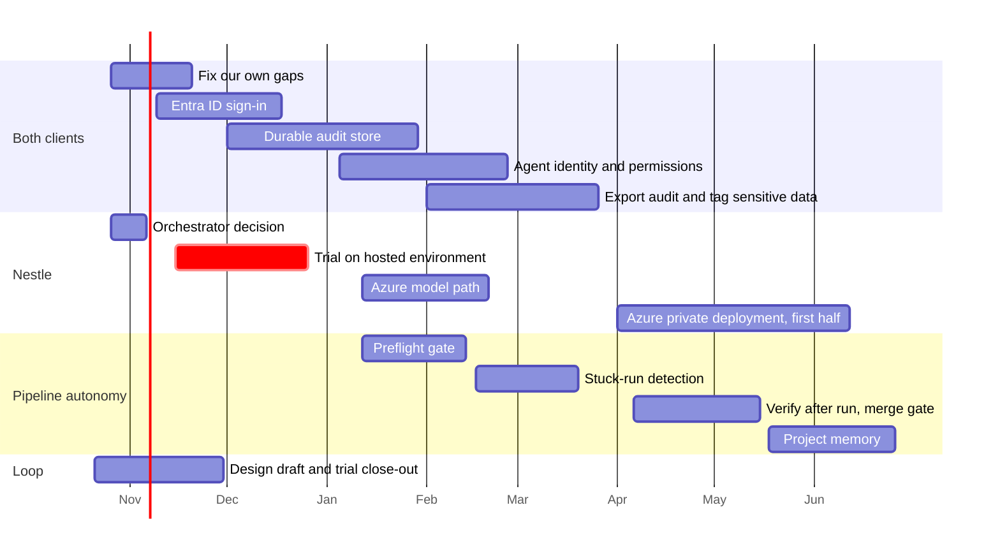

# 🎯 Roadmap — Q4 2026 to Q2 2027

Capacity-first plan for what we build for Loop Capital and Nestlé, in what order, and what we are not
funding. Replaces [ROADMAP.md](ROADMAP.md) (Aug 19 → Sep 30, expired). Client detail lives in
[ALIGNMENT_2026-10](../../clients/ALIGNMENT_2026-10.md); this file owns capacity, sequence and the cut line.

**Last reviewed:** 2026-10-21 · **Status:** draft for decision

## 🔤 Legend

🟢 funded in this roadmap · ⚪ not funded · 🟡 funded only if a condition holds · ✅ verified in code · ⚠️ estimate, not verified

Terms: **MNPI** (material non-public information) · **SIEM** (security event log system, e.g. Sentinel) ·
**LG-n / NZ-n** (proposed Loop / Nestlé tickets in ALIGNMENT) · **engineer-week** = one engineer, one week of build time.

## 🎯 The answer

We can fund about **54 of the 95 engineer-weeks** the two clients' plans need through Q2 2027. The plan funds the
shared foundation first (our own gaps, Entra ID sign-in, audit, agent identity), then Nestlé's path to a
decision, then the first real pre-, during- and post-run pipeline management. About **42 engineer-weeks stay
unfunded**: most of Loop's governance build (24) and the second half of Nestlé's private Azure deployment (14).
They need a paid co-build that funds extra engineers, or a smaller scope.

Nestlé running privately in its own Azure is **Q3 2027 at best** on this plan, not Q2.

## 👥 Capacity

| | Q4 2026 (10 weeks left) | Q1 2027 | Q2 2027 | Total |
|---|---|---|---|---|
| Usable build, engineer-weeks ⚠️ | 15 (11–18) | 19 (15–23) | 19 (15–23) | **53** |

- Counted: three engineers (Kuri, Marwan, Nano). The team table in `CLAUDE.md` and ALIGNMENT list a fourth, Ahmed
  (infrastructure, DevOps, security); sprint 14–16 docs list three, and a GitHub search for `ahmed-brighthive` finds
  no such user. **If Ahmed is active, add about 22 engineer-weeks (Q4 6, Q1 8, Q2 8) and the funded total rises
  from 54 to about 76. Confirm headcount before using any number here.**
- Focus factor: Kuri 40% (also runs releases, specs, demos), Marwan and Nano 65%, about 8% leave.
- Evidence: 703 merged PRs, Jul 29 → Oct 21, five repos; 138 are release or promotion PRs (20%).
- Cut each range about 15% if production incidents continue at the last quarter's rate (about 3 of 12 weeks).
- Concentration risk: Kuri authored 54–75% of code PRs per sprint. One absence stalls both clients.
- Holidays: US Thanksgiving Nov 26–27; Dec 24 → Jan 1 likely near-idle. Locations inferred, not confirmed.

## 🧮 Demand against funding

Sizes convert ALIGNMENT's labels (L ≈ 3–5, M ≈ 2, S ≈ 1 engineer-weeks) ⚠️. They are not team estimates.

| Workstream | Tickets | Demand | Funded | Quarter |
|---|---|---|---|---|
| Fix our own gaps | BH-1593, BH-1595, LG-4 + 3 new | 5 | 🟢 5 | Q4 |
| Entra ID sign-in (both clients) | LG-3 = NZ-4 | 4 | 🟢 4 | Q4 |
| Durable audit store, then export to a SIEM | BH-1580, BH-1595, BH-1510 | 6 | 🟢 6 | Q4–Q1 |
| Agent identity and agent ⊆ user permissions | LG-1, LG-2 | 6 | 🟢 6 | Q1 |
| Sensitive-data tagging (PII, MNPI) | BH-1060, BH-1084, BH-1478 | 2 | 🟢 2 | Q1 |
| Nestlé orchestrator decision, hosted trial | NZ-0, NZ-10 | 2.5 | 🟢 2.5 | Q4 |
| Azure model-provider path | NZ-3 | 3 | 🟢 3 | Q1 |
| Azure private deployment (images, infrastructure as code, state and storage, search, graph database, read-only warehouse access, telemetry) | NZ-1, 2, 5–9 | 26 | 🟡 12 | Q2 |
| Pipeline autonomy: preflight gate, stuck-run detection, post-run verification, verify-then-merge gate, project memory | PA-1 … PA-5 | 12 | 🟢 12 | Q1–Q2 |
| Pipeline autonomy: Airbyte and Synapse adapters | PA-6 | 4 | ⚪ 0 | — |
| Loop design draft and trial close-out | BH-1245 | 1 | 🟢 1 | Q4 |
| Loop governance build: skill sandbox, registry, outbound policy, Microsoft Graph connector, control view | LG-5 … LG-12 | 24 | ⚪ 0 | — |
| **Total** | | **95.5** | **53.5** | |

## 🗺️ Sequence

### What each quarter delivers

| Quarter | Loop Capital | Nestlé | Both |
|---|---|---|---|
| **Q4 2026** | Honest design draft; a product that survives a security review | Trial can start Nov 15, **hosted by Brighthive only** | Our own gaps closed; Entra ID sign-in built; audit storage started |
| **Q1 2027** | Governed agents on Loop's data, audit visible in their SIEM | Azure models usable | Agent identity; sensitive-data tags; first preflight and stuck-run checks |
| **Q2 2027** | Not funded beyond Q1 unless a paid co-build adds engineers | First half of private Azure deployment (decision gated) | Post-run verification on by default; verify-then-merge gate; project memory |

## 🔧 Pipeline autonomy: what the spine closes

State today ✅ (code check 2026-10-21: brightbot `main` at `956f6859`, platform-core `v3.1.1.5-release`).
Projects is proactive monitoring with governed fix proposals, not autonomous pipeline management.

| Phase | Real today | Gap this roadmap closes |
|---|---|---|
| Before a run | Scheduled lineage-aware dbt runs | PA-1 preflight gate: source health, schema contract, freshness, disk |
| During a run | Hourly per-project watchdog, Slack and inbox alerts | PA-2 stuck and slow-run detection, run-level heartbeat |
| After a run | Fix PR with before and after engine logs; a human merges | PA-3 verification on by default; PA-4 verify-then-merge gate and Undo |
| Context state | Project record in Neo4j; `project` skill bucket exists | PA-5 project memory and resume (builds on BH-1353) |
| Engines | Fix PRs and lineage-scoped runs for dbt Cloud only | PA-6 Airbyte and Synapse adapters ⚪ unfunded |

Customer wording until PA-1 to PA-4 ship: "proactive monitoring with governed remediation proposals."

## 🏢 Client commitments

| | Loop Capital | Nestlé |
|---|---|---|
| Dated and committed | Working session 2026-10-21, 10:00 Central. No later date | Trial start Nov 15; January fallback. The year is inferred; the date came from a chat message |
| Success criteria | SQL Server trial: 9 criteria agreed. Governance: none agreed | N-01 … N-08 are our proposals; none agreed |
| Owed by the client | 5 trial blockers (server address, least-privilege login, database list, SSISDB/ReportServer confirmation, known-bad artifacts) | Champion, sponsor, division inventory, trial venue |
| Owed by us | Security review gate unsigned (`SECURITY_REVIEW_GATE.md`) | No Jira ticket exists |
| Not in this roadmap | Longaeva (status unclear); Virginia, Indiana Tech, OneTen, Impact Capital (no client records in this repo) | — |

## ⚠️ Risks

1. **The Loop fit doc overstates status.** It says Loop "passed the first MVP trial goal"; the overview says the decision is TBD.
2. **Wrong comparison set.** Most of Frank Sung's four requirement sections are access control and data-loss prevention, which other vendors cover. We are scored against them where we do not compete.
3. **Controls are log-only in production.** Authorization, the per-tool gate and agent data-read checks run in log-only mode; the remediation trust gate is off. Q4 turns on write blocking first.
4. **Release and promotion toil is 20% of PRs.** The roadmap does not reduce it.
5. **Single point of failure.** Kuri authors most code and runs releases and demos.

## 🚦 Decisions needed

| # | Decision | Owner | By |
|---|---|---|---|
| 1 | Headcount and planned leave: three or four engineers | Kuri | This week |
| 2 | Nestlé: accept the Nov 15 trial on Brighthive-hosted infrastructure; name champion and success criteria | Kuri, Suzanne | Before Nov 1 |
| 3 | Loop: SaaS or Loop's own Azure tenant; is the co-build paid and does it fund engineers | Suzanne, Matt | 2026-10-21 session |
| 4 | Orchestrator for Nestlé's Azure: self-hosted LangGraph or CEMAF (NZ-0) | Kuri | Before Nov 6 |
| 5 | Approve the proposed epics and tickets below | Kuri | This week |

## 🎫 Proposed tickets (for approval — none created)

Existing proposals LG-1 … LG-14 and NZ-0 … NZ-11 stay in [ALIGNMENT](../../clients/ALIGNMENT_2026-10.md). New here:

| ID | Task | Size | Links |
|---|---|---|---|
| OG-1 | Enforce authorization on write actions in production (leave log-only) | S | LG-4, BH-1471, BH-1590 |
| OG-2 | Remove direct OpenAI calls; route every model call through the provider setting | S | — |
| OG-3 | Wire the Usage & Audit page to real events | M | BH-1595 |
| OG-4 | Close the shared on-prem job key so a job claim is scoped to its workspace | S | — |
| OG-5 | Fix the PII-masking bypass on unaliased expressions (`MAX(ssn)`) | S | BH-1593 |
| PA-1 | Preflight gate before a run | M | BH-1255, BH-1511–1515 |
| PA-2 | Stuck and slow-run detection with a run-level heartbeat | M | BH-1255 |
| PA-3 | Post-run verification on by default; enable the profiler snapshots drift needs | M | BH-1061 |
| PA-4 | Verify-then-merge gate with green CI, and Undo | M | BH-1620 |
| PA-5 | Project memory and resume | M | BH-1353 |
| PA-6 | Airbyte and Synapse adapters | L | NZ-8 |
| RM-1 | Parent epic: Pipeline autonomy — before, during, after | — | BH-1255 |

## 🔍 What is not verified

- Demand numbers are conversions of size labels, not estimates from Marwan and Nano. Ask them to size every row before commitments go to clients.
- Capacity comes from merged-PR counts, a weak signal of effort. Sprint documents after Aug 23 are not in this repo.
- The PR counts covered five repos. Across all org repos since 2026-07-29, Marwan has 110 merged PRs (57 in the five)
  and Nano 58 (49), so per-person throughput is understated. Capacity above rests on focus factors, not on these counts.
- Which of Kuri's near-zero PR weeks were incident response, and whether Marwan's two quiet weeks were leave, is unknown.
- Loop's Microsoft licence tier, SIEM and deployment target are unconfirmed.
- Brighthive's SOC 2 Type II status is unconfirmed and can block a regulated-finance deal regardless of engineering.

## 📎 Evidence

- Sprint and release data: `jira/sprint/13` … `16` (`SUMMARY.md`, `stats.json`); merged-PR counts from `gh` across brightbot, platform-core, webapp, e2e and this repo.
- Code state: brightbot `origin/main` `956f6859`, platform-core `v3.1.1.5-release`, webapp `origin/develop`, read 2026-10-21.
- Client facts: [ALIGNMENT_2026-10](../../clients/ALIGNMENT_2026-10.md), [Loop](../../clients/trials/loopcapital/overview.md), [Nestlé](../../clients/trials/nestle/overview.md).
