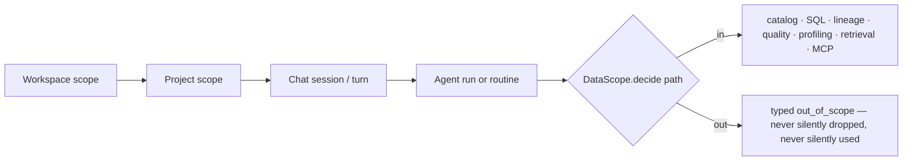

# Data scope — choose exactly what BrightAgent works on, down to the row

> A workspace can hold many warehouses, each with many databases. A person, a Project or an agent run
> picks exactly which parts are **in** and which are **out** — any warehouse, database, schema, table,
> column or set of rows, in any combination — and every BrightAgent surface honours that choice the same way.

## 1. Context

**For whom:** data teams whose workspace spans several warehouses and databases (Impact Capital has three
warehouses; Loop Capital runs one SQL Server per database; Nestlé reads ADLS, Synapse and Databricks side by side).

**The problem:** today there is no way to say "work on these two databases, never touch that one."
What exists is partial and scattered:

| Exists today | Where | Limit |
|---|---|---|
| `@warehouse.database.table` chat grammar, bracketed names | `brightbot/utils/chat_addressing.py` | Only the **warehouse** segment binds; database partly (BH-1447); table never |
| Per-turn `ContextMode` EXTEND / SCOPE toggle | same file, `initialization_middleware.py:226` | Per turn only; no **exclude**; nothing saved on a Project |
| `schemaFilterPattern` excludes | platform-core `omd-schema-filter.ts`, `ingestion-pipeline-filter.ts` | Schema level, catalog ingestion only (BH-642) — agents never see it |
| Databases | `databases: [String!]` on the warehouse | Strings: no edges, no default, nothing can attach to them |
| Table identity | `lineage_id_resolver.py:26` | Matches **last name segment only** — same-named tables in two databases are cross-wired |
| Warehouse choice | 21 `next(iter(...))` sites in brightbot | Silently uses the first warehouse |

**Why now:** the north star (`clients/NORTH_STAR.md` on PR #205's branch) is multi-warehouse, multi-database,
unbounded lineage across engines. None of that is trustworthy while the platform cannot name the full path of
a piece of data and cannot keep an excluded database out of an answer.



Each layer can only **narrow** the one above it. Permission (`authorize()`, BH-1464) decides what someone
*may* see; scope decides what they *chose* to work on. What an agent sees = permitted ∩ in scope.

## 2. Interface Contract (MDE)

### 2a. The path — one address for every level

| Level | Segment | Node today | Node after this spec |
|---|---|---|---|
| 1 | warehouse | `WarehouseServiceNode` | unchanged |
| 2 | database | string in `databases` | **`DatabaseNode`** (BH-1371) |
| 3 | schema | property on the table | path segment (node deferred) |
| 4 | table | `DataAssetNode` | identity scoped by warehouse + database + schema |
| 5 | column | field on the table schema | path segment |
| — | rows | none | `RowFilter` on a table rule (phase 2) |

Attached artifacts (profile, lineage, quality results, sample rows, embeddings) carry their table's decision.

**Chat grammar** (extends the shipped one; no change to existing mentions):

```text
@wh                    warehouse
@wh.db                 database
@wh.db.table           table, schema resolved by the ambiguity ladder (today's 3-segment form)
@wh.db.schema.table    table, fully pinned
@wh.db.schema.table.col  column
-@path                 exclude that path for this turn   (NEW)
@[Loop Capital SQL Server].[Trades DB].dbo.*   bracketed names + segment wildcards (NEW)
```

### 2b. Types (brightbot, `brightbot/scope/`)

```python
class ScopeEffect(StrEnum):
    INCLUDE = "include"
    EXCLUDE = "exclude"

class ScopeLayer(StrEnum):
    WORKSPACE = "workspace"
    PROJECT = "project"
    SESSION = "session"
    RUN = "run"

@dataclass(frozen=True)
class DataPath:
    warehouse_id: str
    database: str | None = None
    schema: str | None = None
    table: str | None = None
    column: str | None = None

@dataclass(frozen=True)
class PathPattern:
    """Segments are exact names or globs (`stg_*`, `*`); fewer segments = broader."""
    segments: tuple[str, ...]

@dataclass(frozen=True)
class RowFilter:          # phase 2
    column: str
    operator: Literal["=", "!=", "in", "not in", "<", "<=", ">", ">="]
    values: tuple[str | int | float, ...]

@dataclass(frozen=True)
class ScopeRule:
    effect: ScopeEffect
    pattern: PathPattern
    layer: ScopeLayer
    row_filter: RowFilter | None = None
    rule_id: str = ""

@dataclass(frozen=True)
class ScopeDecision:
    included: bool
    decided_by: ScopeRule | None      # None = inherited default
    layer: ScopeLayer

class DataScope(Protocol):
    def decide(self, *, path: DataPath) -> ScopeDecision: ...
    def expand(self, *, level: Literal["warehouse", "database", "schema", "table"],
               under: DataPath | None) -> list[DataPath]: ...
    def row_filters(self, *, path: DataPath) -> tuple[RowFilter, ...]: ...
    def describe(self) -> str: ...      # plain sentence used in answers (Invariant 10)

def build_scope(*, workspace_id: str, project_id: str | None, session_rules: Sequence[ScopeRule],
                run_rules: Sequence[ScopeRule], catalog: WarehouseCatalog) -> DataScope: ...
```

Errors (typed, never a bare 500): `out_of_scope(path, decided_by)`, `ambiguous(matches)`, `not_found(path)`,
`incoherent(pin, path)` — the last three are the identity spec's §2e ladder, reused unchanged.

### 2c. Storage + API (platform-core)

```graphql
type DatabaseNode {
  id: ID! @id
  name: String!
  isDefault: Boolean!
  warehouse: WarehouseServiceNode! @relationship(type: "HAS_DATABASE", direction: IN)
  tables: [DataAssetNode!]! @relationship(type: "HAS_TABLE", direction: OUT)
}

type ScopeRuleNode {
  id: ID! @id
  effect: ScopeEffect!            # INCLUDE | EXCLUDE
  pattern: [String!]!             # path segments, globs allowed
  rowFilter: RowFilterInput       # phase 2
  createdBy: String!
  createdAt: DateTime!
}
# (ProjectNode|WorkspaceNode)-[:HAS_SCOPE_RULE]->(ScopeRuleNode)

type Query {
  databases(warehouseId: ID!): [DatabaseNode!]!
  tablesInDatabase(databaseId: ID!, schema: String): [DataAssetNode!]!
  resolveTable(name: String!, warehouseId: ID, databaseId: ID, schema: String): ResolveTableResult!
  scopeRules(projectId: ID, workspaceId: ID!): [ScopeRuleNode!]!
}
type Mutation {
  setScopeRules(projectId: ID, workspaceId: ID!, rules: [ScopeRuleInput!]!): [ScopeRuleNode!]!  # replace-all, idempotent
}
```

`setScopeRules` is gated by `authorize(UPDATE, PROJECT|WORKSPACE)` and audited.

## 3. Invariants (DbC)

1. **One resolver.** Every read and write surface — catalog listing, introspection, NL→SQL (natural language
   to SQL), lineage, quality, profiling, retrieval/embeddings, MCP tools, routines — decides through
   `DataScope.decide`. No surface keeps its own filter.
2. **Exclusion is absolute.** IF a path is out of scope, THEN THE System SHALL NOT return its rows, columns,
   names, samples, profiles, embeddings or lineage nodes to the model or the user.
3. **Layers only narrow.** A lower layer's INCLUDE can never bring back what a higher layer excludes.
   Effective scope = workspace ∩ project ∩ session ∩ run.
4. **Most specific rule wins; at equal specificity EXCLUDE wins.** Specificity = number of non-wildcard
   segments, then segment count.
5. **Defaults.** A layer with no INCLUDE rules inherits its parent's set. Once a layer has any INCLUDE rule,
   anything not matched by an INCLUDE is out (default-deny for that layer).
6. **New data follows the pattern, not the snapshot.** A database or table created later is in scope only if
   an INCLUDE pattern matches it; explicit name lists never auto-grow.
7. **Path identity is full.** Table identity is unique on (warehouse, database, schema, name) — never on
   `name` alone (identity spec Invariant 2). Lineage, quality and profiling key on this identity.
8. **No silent first match.** WHEN a name matches more than one in-scope path, THE System SHALL return
   `ambiguous` and ask — never `next(iter(...))`. Out-of-scope matches do not count toward ambiguity.
9. **SQL is checked before it runs.** Every table referenced by generated or user-supplied SQL is resolved and
   decided before execution; any out-of-scope reference fails the whole statement with `out_of_scope`.
10. **Answers say their scope.** Every answer that read data states the warehouse, database, and — when any
    rule applied — one plain sentence of scope (`DataScope.describe`).
11. **Scope values are never interpolated into SQL.** Names and row-filter values reach the warehouse only as
    bound parameters or dialect-quoted identifiers (fixes `warehouse_base.py:272`, `warehouse_snowflake.py:509`).
12. **Backfill is re-runnable.** Creating `DatabaseNode`s from existing `databases` strings run twice yields
    the same graph, no duplicates.
13. **Row filters compose by AND** and are applied in the warehouse (pushed down), never by post-filtering
    rows already fetched into BrightAgent.

## 4. Acceptance Criteria (Gherkin)

```gherkin
Feature: Data scope

  Background:
    Given a workspace with warehouses "snow_prod" (databases SALES, HR, SANDBOX) and "mssql_loop" (databases trades, risk)
    And table "orders" exists in snow_prod.SALES.public and snow_prod.SANDBOX.public

  Scenario: Include two databases in a Project
    Given Project "Revenue" includes "snow_prod.SALES" and "mssql_loop.trades"
    When I ask "list the tables I can work with"
    Then only tables from snow_prod.SALES and mssql_loop.trades are listed
    And the answer names the scope in one sentence

  Scenario: Exclude a database from the whole workspace
    Given the workspace excludes "snow_prod.HR"
    When a Project includes "snow_prod.*"
    Then snow_prod.HR is still out of scope for that Project

  Scenario: Most specific rule wins
    Given Project includes "snow_prod.SALES" and excludes "snow_prod.SALES.public.salaries"
    When I query "salaries"
    Then I get out_of_scope naming the exclude rule

  Scenario: Equal specificity, exclude wins
    Given Project includes "snow_prod.*" and excludes "snow_prod.*"
    Then snow_prod has nothing in scope

  Scenario: Same-named table, one in scope
    Given Project includes "snow_prod.SALES" only
    When I ask for "orders"
    Then it resolves to snow_prod.SALES.public.orders without asking

  Scenario: Same-named table, both in scope
    Given Project includes "snow_prod.SALES" and "snow_prod.SANDBOX"
    When I ask for "orders"
    Then I am asked which one, with both full paths listed

  Scenario: Exclude for one chat turn
    Given Project "Revenue" includes "snow_prod.*"
    When I send "summarise revenue -@snow_prod.SANDBOX"
    Then no SANDBOX table is read for that turn
    And the next turn is back to the Project scope

  Scenario: Chat cannot widen a Project
    Given Project "Revenue" includes "snow_prod.SALES" only
    When I send "compare @snow_prod.HR.public.staff with orders"
    Then I get out_of_scope for snow_prod.HR — the mention does not override the Project

  Scenario: Generated SQL touching an excluded table
    Given Project excludes "snow_prod.SALES.public.salaries"
    When the agent generates SQL joining orders to salaries
    Then the statement is not executed and the answer explains which table is out of scope

  Scenario: New database appears after scope is set
    Given Project includes "snow_prod.SALES*"
    When database SALES_EU is created in snow_prod
    Then SALES_EU is in scope
    And a database named MARKETING is not

  Scenario: Lineage stops at the scope boundary
    Given Project includes "snow_prod.SALES" only
    When I ask for downstream lineage of orders
    Then nodes outside scope are not named
    And the answer says how many downstream nodes are hidden by scope

  Scenario: First warehouse is never guessed
    Given the workspace has two Snowflake warehouses and no pin
    When I ask a question that needs one warehouse
    Then the stored default warehouse is used and named in the answer

  Scenario: Backfill twice
    Given warehouses with existing databases strings
    When the DatabaseNode backfill runs twice
    Then each database exists exactly once with one default per warehouse

  Scenario: Row filter (phase 2)
    Given Project includes "mssql_loop.trades.dbo.fills" with rows where desk = 'EQ'
    When I count fills
    Then the warehouse receives a parameterized WHERE desk = ? and only EQ rows are counted
```

## 5. Out of Scope

- ResourceNode / JobNode graph levels, WarehouseBuilder writes, rename cascades (identity spec §2b/§2f — deferred there too).
- Scope as an access-control mechanism — permission stays with `authorize()`; scope never grants.
- Cross-warehouse joins / federation.
- Schema and column as Neo4j nodes (path segments are enough until a second consumer needs edges).

## 6. Dependencies

- BH-1371 / BH-1373 / BH-1374 / BH-1393 (DatabaseNode, backfill, scoped uniqueness, default database) — first.
- BH-1378 (`databases`, `tablesInDatabase`, `resolveTable`).
- BH-1464 `authorize()` for `setScopeRules`.
- `chat_addressing.py` grammar (shipped) — extended, not replaced.

## 7. Correctness Properties

### Property 1: Excluded data never reaches the model
*For any* rule set and any surface, if `decide(path).included` is false, no token derived from that path appears
in model context or user output. **Validates: §3 Invariants 1, 2, 9; §4 "Generated SQL touching an excluded table", "Lineage stops at the scope boundary"**

### Property 2: Narrowing is monotone
*For any* layers L1 ⊇ L2, adding rules to L2 never makes a path in scope that L1 has out.
**Validates: §3 Invariant 3; §4 "Exclude a database from the whole workspace", "Chat cannot widen a Project"**

### Property 3: Decisions are deterministic and order-independent
*For any* permutation of the same rule set, `decide` returns the same result.
**Validates: §3 Invariant 4; §4 "Most specific rule wins", "Equal specificity, exclude wins"**

### Property 4: No silent first match
*For any* name with ≥2 in-scope matches, resolution returns `ambiguous`.
**Validates: §3 Invariant 8; §4 "Same-named table, both in scope", "First warehouse is never guessed"**

Property tests (Hypothesis) generate random rule sets and paths for Properties 2–3.

## 8. Eval Criteria

| Evaluator | Node | Mode | Threshold | Method |
|---|---|---|---|---|
| ScopeLeakEvaluator | every answer that read data | GATE | 0 out-of-scope identifiers | deterministic (compare output tokens to excluded paths) |
| ScopeDisclosureEvaluator | same | OBSERVE | ≥ 0.95 answers name warehouse + database | deterministic |

## 9. Observability Contract

- **Span attributes** on every data-reading tool span: `brighthive.scope.layer_count`, `brighthive.scope.rule_count`,
  `brighthive.scope.decision` (`in`/`out`), `brighthive.scope.decided_by_rule_id`, `workspace.id`, `project.id`.
- **Log events:** `scope.out_of_scope`, `scope.ambiguous`, `scope.rules_changed` (audited, with actor).
- **Metric:** `scope_out_of_scope_total{surface}`.

## 10. Test Coverage Update

| Layer | Where | Cases |
|---|---|---|
| L0 surface | `brighthive-platform-core/tests/` | `databases`, `tablesInDatabase`, `resolveTable`, `scopeRules`, `setScopeRules` shapes + error codes |
| L1 routing | `brightbot/brightbot/evals/layers/routing.py` | `-@` and `@` mentions reach `build_scope` with the right layer |
| L2 behavior | `brightbot/tests/scope/` + evals behavior | one per §4 scenario; Properties 2–3 as Hypothesis tests; ScopeLeakEvaluator gate |
| Real backend | local Neo4j (backfill twice) + staging workspace with three warehouses | Backfill, ambiguity, out_of_scope SQL |
| e2e | `brighthive-e2e/e2e/` | Project include/exclude drill-down + chat exclude, against the real backend |

Fixtures come from a captured staging catalog listing (three-warehouse workspace), not hand-typed shapes.

## Ticket breakdown

Existing (BH-1370): BH-1371, BH-1373, BH-1374, BH-1393, BH-1378, BH-1380, BH-1381, BH-1382, BH-1383, BH-1600.
Proposed new (await approval):

| ID | Task | Repo |
|---|---|---|
| SC-1 | `ScopeRuleNode` + `scopeRules` / `setScopeRules` (authorized, audited) | platform-core |
| SC-2 | `brightbot/scope/` — `DataScope` resolver, precedence, layers, property tests | brightbot |
| SC-3 | SQL scope check before execution + parameterize schema filters (Invariants 9, 11) | brightbot |
| SC-4 | Lineage identity on full path + scope-bounded traversal with hidden count | brightbot |
| SC-5 | Chat `-@` exclude + wildcards + schema/column segments in `chat_addressing.py` | brightbot |
| SC-6 | Project scope editor: warehouse → database → schema → table tree with include/exclude | webapp |
| SC-7 | Row filters pushed down as parameters (phase 2) | brightbot + platform-core |
| SC-8 | e2e: Project scope + chat exclude feature tests | brighthive-e2e |

## Open question

"Resource" in the request (warehouse → database → table → resource → row): this spec reads it as the artifacts
attached to a table (profile, lineage, quality, samples), which inherit the table's decision, plus **column** as
level 5. Confirm, or name what a resource is.
