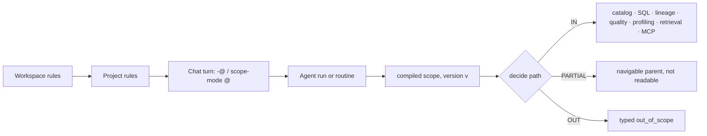

# Data scope — choose exactly what BrightAgent works on

> A workspace can hold many warehouses, each with many databases. A person, a Project or an agent run picks
> exactly which parts are **in** and which are **out** — any warehouse, database, schema, table or column, in
> any combination — and every BrightAgent surface honours that choice the same way. Row-level scope is its
> own spec (§5).

## 1. Context

**For whom:** data teams whose workspace spans several warehouses and databases (Impact Capital has three
warehouses; Loop Capital runs one SQL Server per database; Nestlé reads ADLS, Synapse and Databricks side by side).

**The problem:** there is no way to say "work on these two databases, never touch that one." What exists is
partial and scattered:

| Exists today | Where | Limit |
|---|---|---|
| `@warehouse.database.table` chat grammar, bracketed names | `brightbot/utils/chat_addressing.py` | Only the **warehouse** segment binds; database partly (BH-1447); table never |
| Per-turn `ContextMode` EXTEND / SCOPE toggle | same file; `initialization_middleware.py:226` | Per turn only; no **exclude**; nothing saved on a Project |
| `schemaFilterPattern` excludes | platform-core `omd-schema-filter.ts`, `ingestion-pipeline-filter.ts` | Decides what the **catalog ingests** (BH-642) — stays as is; scope narrows inside it |
| Databases | `databases: [String!]` + `defaultDatabase` on the warehouse | Strings: no edges, nothing can attach to them |
| Table identity | `lineage_id_resolver.py:26` | Matches the **last name segment only** — same-named tables in two databases are cross-wired |
| Warehouse choice | 21 `next(iter(...))` sites in brightbot | Silently uses the first warehouse |

**Why now:** the north star — multi-warehouse, multi-database, unbounded lineage across engines — is not
trustworthy while the platform cannot name the full path of a piece of data and cannot keep an excluded
database out of an answer.



**Scope is not permission.** `authorize()` (BH-1464) decides what someone *may* see; scope decides what they
*chose* to work on. What an agent sees = permitted ∩ in scope. Anything sensitive belongs in `authorize()`
and warehouse grants, not in a scope rule.

## 2. Interface Contract (MDE)

### 2a. The path

| Level | Field | Graph today | After this spec |
|---|---|---|---|
| 1 | `warehouse` | `WarehouseServiceNode` | unchanged |
| 2 | `database` | string in `databases` | **`DatabaseNode`** (BH-1371) |
| 3 | `schema` | `DataAssetNode.schemaName` | named field (no node — the existing `SchemaNode` is target-schema validation, a different concept; never conflate) |
| 4 | `table` | `DataAssetNode` | identity on (warehouse, database, schema, table) |
| 5 | `column` | table schema | named field — slice 2 |

Artifacts attached to a table (profile, lineage, quality results, sample rows, embeddings) carry their table's decision.
Engines with fewer levels (Databricks catalog.schema.table; ADLS container/path) declare their level shape as a
warehouse capability; missing levels are fixed by the adapter, never guessed.

**Chat grammar** (extends the shipped one):

```text
@wh                      warehouse
@wh.db                   database
@wh.db.x                 x resolved to exactly one of schema | table; both exist → ambiguous (ask)
@wh.db.schema.table      table, fully pinned
@wh.db.schema.*          whole schema, explicit form
-@path                   exclude path for this turn — parsed by its own pattern; NEVER sets a pin   (NEW)
@[Loop Capital SQL Server].[Trades DB].dbo.*   bracketed names + segment globs                       (NEW)
```

Mentions are matched with a lookbehind `(?<![\w-])@` so `-@x` and `name@host.com` never pin anything.

How mentions map to rules:

| Turn input | Rule created |
|---|---|
| `@path` in EXTEND mode (default) | none — a pin / tiebreak only, as today |
| `@path` in SCOPE mode | turn INCLUDE |
| `-@path` (either mode) | turn EXCLUDE |

### 2b. Types (brightbot `brightbot/scope/`)

```python
class ScopeEffect(StrEnum):
    INCLUDE = "include"
    EXCLUDE = "exclude"

class ScopeLayer(StrEnum):
    WORKSPACE = "workspace"
    PROJECT = "project"
    TURN = "turn"
    RUN = "run"            # routines, scheduled agents

class Inclusion(StrEnum):
    IN = "in"
    PARTIAL = "partial"    # a parent with some, not all, children in — navigable, not readable as a whole
    OUT = "out"

@dataclass(frozen=True)
class DataPath:
    warehouse_id: str
    database: str | None = None
    schema: str | None = None
    table: str | None = None
    column: str | None = None

@dataclass(frozen=True)
class PathPattern:
    """Named fields; each is an exact name, a glob (`stg_*`, `*`), or None (= any, deeper levels unconstrained)."""
    warehouse_id: str
    database: str | None = None
    schema: str | None = None
    table: str | None = None
    column: str | None = None

@dataclass(frozen=True)
class ScopeRule:
    rule_id: str           # required, unique
    effect: ScopeEffect
    pattern: PathPattern
    layer: ScopeLayer

@dataclass(frozen=True)
class ScopeDecision:
    inclusion: Inclusion
    excluded_by: str | None      # rule_id; for WORKSPACE rules the user sees the rule, not the path
    layer: ScopeLayer | None

class CompiledScope:              # concrete class; one implementation, tested with real rule sets
    version: str
    def decide(self, *, path: DataPath) -> ScopeDecision: ...
    def list_children(self, *, under: DataPath | None, cursor: str | None, limit: int) -> ScopePage: ...
    def describe(self) -> str: ...  # one plain sentence, appended deterministically to answers
```

Typed errors (never a bare 500): `out_of_scope`, `out_of_scope_unverifiable`, `scope_unavailable`,
`ambiguous`, `not_found`, `incoherent` (the last three are the identity spec's ladder, reused).

### 2c. Storage + API (platform-core)

```graphql
type DatabaseNode {
  id: ID! @id
  warehouseServiceId: String!   # with name: composite uniqueness
  name: String!                 # as the server reports it
  isDefault: Boolean
  lastReportedAt: DateTime      # last verification that saw it; never auto-deleted when it disappears
  warehouse: WarehouseServiceNode! @relationship(type: "HAS_DATABASE", direction: IN)
  tables: [DataAssetNode!]! @relationship(type: "HAS_TABLE", direction: OUT)
}

type ScopeRuleNode {
  id: ID! @id
  effect: ScopeEffect!
  warehouseServiceId: String!   # keyed by id; rule for an unknown warehouse → fail closed (Inv 8)
  database: String  schema: String  table: String  column: String
  createdBy: String!  createdAt: DateTime!
}
# (ProjectNode|WorkspaceNode)-[:HAS_SCOPE_RULE]->(ScopeRuleNode)

type EffectiveScope { version: String!, layers: [ScopeLayerRules!]! }

type Query {
  databases(warehouseId: ID!): [DatabaseNode!]!
  tablesInDatabase(databaseId: ID!, schema: String, after: String, first: Int): DataAssetConnection!
  resolveTable(name: String!, warehouseId: ID, databaseId: ID, schema: String): ResolveTableResult!
  effectiveScope(workspaceId: ID!, projectId: ID): EffectiveScope!
}
type Mutation {
  setScopeRules(workspaceId: ID!, projectId: ID, rules: [ScopeRuleInput!]!,
                expectedVersion: String, idempotencyKey: String!): EffectiveScope!
}
```

`setScopeRules` replaces all rules of one layer atomically, rejects a stale `expectedVersion`, is gated by
`authorize(UPDATE, PROJECT|WORKSPACE)`, and is audited. A pattern matching nothing returns a typed warning,
not an error (future data may match).

## 3. Invariants (DbC)

1. **One decision function, two conforming evaluators.** Every surface decides through `CompiledScope.decide`
   (brightbot) or its platform-core twin. Both pass the shared case file `scope-conformance.json` in CI.
2. **Deny overrides.** Within a layer, `IN(path) ⇔ (layer has no INCLUDE ∨ some INCLUDE matches) ∧ no EXCLUDE matches`.
   To carve one table back out of an excluded database, include that table explicitly — there is no specificity contest.
3. **Layers only narrow.** Effective inclusion = AND across workspace, project, turn, run.
4. **New data follows patterns.** A database or table created later is in scope only if an INCLUDE pattern matches;
   explicit names never auto-grow.
5. **Parents are navigable.** A parent of an IN path is PARTIAL: it can be listed for navigation, never read as a whole.
6. **Names match the engine's rules.** Snowflake folds unquoted names to upper case, Redshift and Databricks to lower,
   SQL Server per database collation. Matching normalizes per engine before comparing.
7. **Table identity is the full path** — unique on (warehouse, database, schema, table), never on name alone.
   Lineage, quality and profiling key on it.
8. **Fail closed.** WHEN rules cannot be loaded within `SCOPE_LOAD_TIMEOUT_S`, or a rule names a warehouse id the
   workspace no longer has, THE System SHALL return `scope_unavailable` for data reads — never treat it as "no rules".
9. **No silent first match.** Two or more in-scope matches → `ambiguous`. Out-of-scope matches do not count, and
   the error never reveals that an out-of-scope object exists.
10. **SQL is checked once, at the warehouse execute boundary**, before it runs: every referenced table is qualified with
    the connection's current database/schema and decided. Parse failures, multi-statement input, `USE`, dynamic SQL
    (`EXECUTE IMMEDIATE`, `sp_executesql`, `EXEC`, `IDENTIFIER()`), `CALL`, `RESULT_SCAN` and four-part names fail
    with `out_of_scope_unverifiable`. Metadata queries (`INFORMATION_SCHEMA`, `SHOW`, `sys.*`) are filtered to scope.
    Views are decided on the view's own path (documented: a view over an excluded table is visible if the view is in).
11. **Retrieval is pre-filtered.** Vector search filters by warehouse/database/schema tags in the query, catalog search
    by full-name prefix, and cached schema context is keyed by scope version.
12. **Answers say their scope.** Every answer that read data names the warehouse and database and appends
    `describe()` when any rule applied. Deterministic, not model-generated.
13. **Forward-only.** Scope applies to every read from the turn it is set; earlier turns are not redacted, and the
    `describe()` sentence says so when a `-@` narrows mid-conversation.
14. **Values are never interpolated into SQL.** Names reach the warehouse as dialect-quoted identifiers, values as bound
    parameters (fixes `warehouse_base.py:272`, `warehouse_snowflake.py:509`).
15. **Backfill is re-runnable.** Creating `DatabaseNode`s from stored `databases` strings twice yields the same graph.
    A warehouse's default database comes from `defaultDatabase`, else the creation-time `database` if reported, else
    the only database; with several and no signal, none is marked and the resolver asks.

## 4. Acceptance Criteria (Gherkin)

```gherkin
Feature: Data scope

  Background:
    Given warehouse "snow_prod" (databases SALES, HR, SANDBOX) and warehouse "mssql_loop" (databases trades, risk)
    And table "orders" exists in snow_prod.SALES.public and snow_prod.SANDBOX.public

  Scenario: Include two databases in a Project
    Given Project "Revenue" includes snow_prod.SALES and mssql_loop.trades
    When I ask "list the tables I can work with"
    Then only tables from those two databases are listed and the answer names the scope

  Scenario: Workspace exclude cannot be undone below
    Given the workspace excludes snow_prod.HR
    When a Project includes snow_prod.*
    Then snow_prod.HR is out for that Project

  Scenario: Exclude wins regardless of how specific the include is
    Given Project includes snow_prod.SALES and excludes table "salaries" in any database
    When I query salaries
    Then I get out_of_scope

  Scenario: Same-named table, one in scope
    Given Project includes snow_prod.SALES only
    When I ask for "orders"
    Then it resolves to snow_prod.SALES.public.orders without asking

  Scenario: Same-named table, both in scope
    Given Project includes snow_prod.SALES and snow_prod.SANDBOX
    When I ask for "orders"
    Then I am asked which one, with both full paths listed

  Scenario: Exclude for one turn never pins
    Given Project "Revenue" includes snow_prod.*
    When I send "summarise revenue -@snow_prod.SANDBOX"
    Then no SANDBOX table is read, SANDBOX is not the pinned database, and the next turn is back to the Project scope

  Scenario: Chat cannot widen a Project
    Given Project "Revenue" includes snow_prod.SALES only
    When I send "compare @snow_prod.HR.public.staff with orders"
    Then I get out_of_scope for snow_prod.HR

  Scenario: Generated SQL touching an excluded table
    Given Project excludes snow_prod.SALES.public.salaries
    When the agent generates SQL joining orders to salaries
    Then the statement is not executed and the answer names the excluded table

  Scenario: Dynamic SQL cannot be verified
    When the agent generates "EXEC sp_executesql @stmt"
    Then the statement fails with out_of_scope_unverifiable

  Scenario Outline: Name casing follows the engine
    Given a rule including <rule> on a <engine> warehouse whose database is <stored>
    Then that database is <result>
    Examples:
      | engine     | rule  | stored    | result |
      | snowflake  | sales | SALES     | in     |
      | snowflake  | sales | "Sales"   | out    |
      | redshift   | SALES | sales     | in     |

  Scenario: New database matching a pattern
    Given Project includes snow_prod.SALES*
    When database SALES_EU is created
    Then SALES_EU is in scope and a new database MARKETING is not

  Scenario: Rule for a deleted warehouse fails closed
    Given the workspace excludes a database on a warehouse that is later deleted and re-registered with a new id
    When an agent reads from the re-registered warehouse
    Then it gets scope_unavailable until an admin updates the rules

  Scenario: Rules cannot load
    Given the rule store does not answer within the timeout
    When an agent reads data
    Then it gets scope_unavailable, never unscoped data

  Scenario: Concurrent rule edits
    Given two admins save different rule sets with the same expectedVersion
    Then exactly one wins and the other gets a stale-version error

  Scenario: First warehouse is never guessed
    Given two Snowflake warehouses, one marked default
    When a question needs one warehouse and none is pinned
    Then the default is used and named in the answer

  Scenario: Backfill twice
    Given warehouses with stored databases strings
    When the DatabaseNode backfill runs twice
    Then each database exists once, tables are linked by HAS_TABLE, and at most one database per warehouse is default
```

## 5. Out of Scope

- **Row-level scope** — its own spec (pushdown means rewriting the SQL tree; warehouse row-access policies are the better tool).
- Column scope in slice 1 (slice 2 rule: a statement reading an excluded column, including `*`, is blocked).
- Scope as access control — sensitive data goes through `authorize()` and warehouse grants.
- ResourceNode / JobNode, WarehouseBuilder writes, rename cascades (identity spec).
- dbt runs (`ref`/`source`) — they do not pass the execute boundary; checking them against the manifest is a follow-up.
- Retroactive redaction of conversation history (Inv 13).

## 6. Dependencies

- BH-1371 / BH-1373 / BH-1393 (DatabaseNode, backfill, default database) — first. BH-1374 scoped uniqueness follows a
  duplicate audit on staging data.
- BH-1378 (`databases`, `tablesInDatabase`, `resolveTable`). BH-1464 `authorize()` for `setScopeRules`.
- `chat_addressing.py` (shipped) — extended. `pii_masking.py` sqlglot parse — reused for Inv 10, not duplicated.
- `hypothesis` added to brightbot dev dependencies.

## 7. Correctness Properties

### Property 1: An OUT path is never read
*For any* rules and surface, if `decide(path).inclusion` is OUT, no tool result span records that path as read.
**Validates: §3 Inv 1, 10, 11; §4 "Generated SQL touching an excluded table", "Dynamic SQL cannot be verified"**

### Property 2: Narrowing is monotone
*For any* rule set R and extra rules E at any layer, adding E never turns an OUT path IN.
**Validates: §3 Inv 2, 3; §4 "Workspace exclude cannot be undone below", "Chat cannot widen a Project"**

### Property 3: Order does not matter
*For any* permutation or duplication of a rule set, `decide` returns the same inclusion and the same `excluded_by`
(lowest `rule_id` among matching excludes). **Validates: §3 Inv 2; §4 "Exclude wins regardless…"**

### Property 4: Fail closed
*For any* load failure or unknown warehouse id in a rule, data reads return `scope_unavailable`.
**Validates: §3 Inv 8; §4 "Rules cannot load", "Rule for a deleted warehouse fails closed"**

Property tests (Hypothesis, `derandomize=True`) use a small name pool to force collisions and compare `decide`
against a brute-force reference written straight from Inv 2–3.

## 8. Eval Criteria

| Evaluator | Node | Mode | Threshold | Method |
|---|---|---|---|---|
| ScopeLeakEvaluator | every data-reading tool span | GATE | `scope.paths_out_read == 0` | deterministic, from span attributes |
| ScopeTokenLeakCheck | final answer | OBSERVE | 0 canary names from an excluded sandbox database | deterministic token match |

## 9. Observability Contract

- **Span attributes** on data-reading tool spans: `brighthive.scope.version`, `brighthive.scope.paths_in`,
  `brighthive.scope.paths_out_read`, `brighthive.scope.excluded_by`, `workspace.id`, `project.id`.
- **Log events:** `scope.out_of_scope`, `scope.unverifiable`, `scope.unavailable`, `scope.ambiguous`,
  `scope.rules_changed` (audited, with actor), `scope.rule_matches_nothing`.
- **Metric:** `scope_out_of_scope_total{surface}`.
- **Cache:** compiled scope in Redis at `scope:{workspace}:{project}:{version}`, TTL from config; a run snapshots the
  version at start.

## 10. Test Coverage Update

| Layer | Where (extend first) | Cases |
|---|---|---|
| L0 | platform-core `tests/integration/warehouse-default.behavior.test.ts`; new `database-node-backfill.behavior.test.ts` | DatabaseNode shape, backfill twice, default rules, query shapes and error codes |
| L0 | brightbot MCP tool registry test | every data-touching tool declares and passes the scope check |
| L1 | `tests/unit/tools/test_chat_addressing_warehouse_pin.py`, `evals/layers/routing.py` | `-@`, lookbehind, globs, brackets with dots, mention → rule mapping |
| L2 | new `tests/unit/scope/`; `test_lineage_id_resolver.py`; `test_warehouse_routing.py`; warehouse dialect tests | §4 scenarios, Properties 2–3, full-path lineage identity, no first-warehouse guess, Inv 14 |
| Conformance | `scope-conformance.json`, run by both repos | shared decision cases |
| Real backend | local Neo4j (backfill twice); staging workspace `e3fc0917` (three warehouses) read-only | backfill counts, ambiguity, out_of_scope SQL |
| e2e | `brighthive-e2e/e2e/surfaces/test_warehouse_defaults.py`, `test_neo4j_integrity.py`, `features/projects/test_lifecycle.py` | one default per warehouse, every asset one HAS_TABLE, Project include/exclude |

Fixtures are captured from staging (`warehouses{id,name,type,databases,defaultDatabase}`, `dataAssets{warehouseServiceId,databaseName,schemaName,name}`), shape only, never credentials.

## Ticket breakdown

Existing (BH-1370): BH-1371, BH-1373, BH-1393, BH-1374, BH-1378, BH-1380, BH-1381, BH-1382, BH-1383, BH-1600.
Proposed new (await approval):

| ID | Task | Repo |
|---|---|---|
| SC-1 | `ScopeRuleNode`, `effectiveScope`, `setScopeRules` (versioned, authorized, audited) | platform-core |
| SC-2 | `brightbot/scope/` compiled scope + conformance cases + property tests | brightbot |
| SC-3 | SQL check at the execute boundary (reuse `pii_masking` parse) + quote/bind fixes | brightbot |
| SC-4 | Retrieval pre-filter: vector tags (reindex), catalog prefix, cache key by version | brightbot |
| SC-5 | Chat `-@`, lookbehind fix, globs, schema segment | brightbot |
| SC-6 | Lineage identity on the full path | brightbot |
| SC-7 | Project scope editor (warehouse → database → schema → table, include/exclude) | webapp |
| SC-8 | e2e Project scope + chat exclude | brighthive-e2e |

## Open question

"Resource" in the original ask (warehouse → database → table → resource → row): read here as the artifacts
attached to a table, which inherit its decision, plus column as level 5. Confirm, or name what a resource is.
